# FishBowl

FishBowl is a hub for your emulators and games. It keeps your installed emulators, your game library, saves and setup information in one place, and launches everything with the emulator you already use.

| Platform | Version | Status |
| --- | --- | --- |
| Windows | 1.29.3 | Current release |
| Linux | 1.29.3 | AppImage on the latest release; Linux desktop testing remains required |

Source version **1.29.4** adds a Windows Web workspace using installed Firefox by default, selectable Edge/Chrome adapters and separate browser profiles. Browser windows fit the Web viewport automatically; Open in window starts at that size and position. Play includes game-only view adjustments and confirmation before closing running games, with normal emulator shutdown, recognized plain exit confirmations handled after FishBowl approval, and save/unknown prompts available inside FishBowl. Active-game section switching uses owned renderers and cached placement. It retains session recovery, controller navigation, Home customization and the existing game, save and integration tools. The public release is 1.29.3; newer source changes require review and CI before release. Download complete app and source bundles from the latest passing Build workflow, or build from source. See [Browser setup](docs/BROWSER.md) for requirements and native-window compatibility.

For Windows, choose **FishBowl-1.29.4.zip** to run the app; keep its six files together. **FishBowl-1.29.4-Source.zip** is for building or reviewing code and contains no compiled app. Packages include matching app/installer versions, source commit metadata, checksums and upgrade/rollback instructions. See [Play validation](docs/PLAY-VALIDATION.md) for emulator, controller, monitor and remote tests.

## Screenshots

These are from the Linux version, with made-up example games. The Windows version has the same sections, plus Play and Web, where games and websites run inside FishBowl.

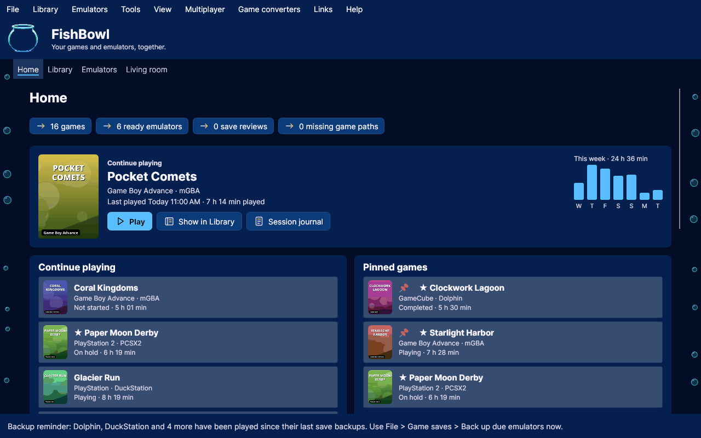

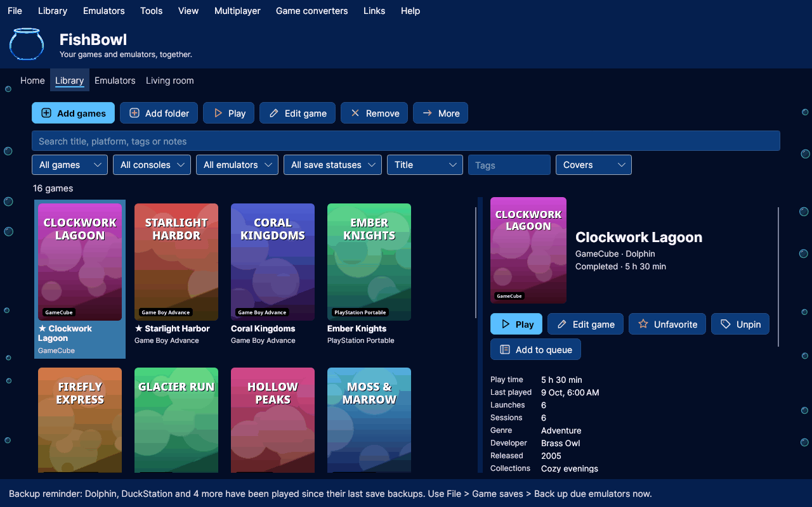

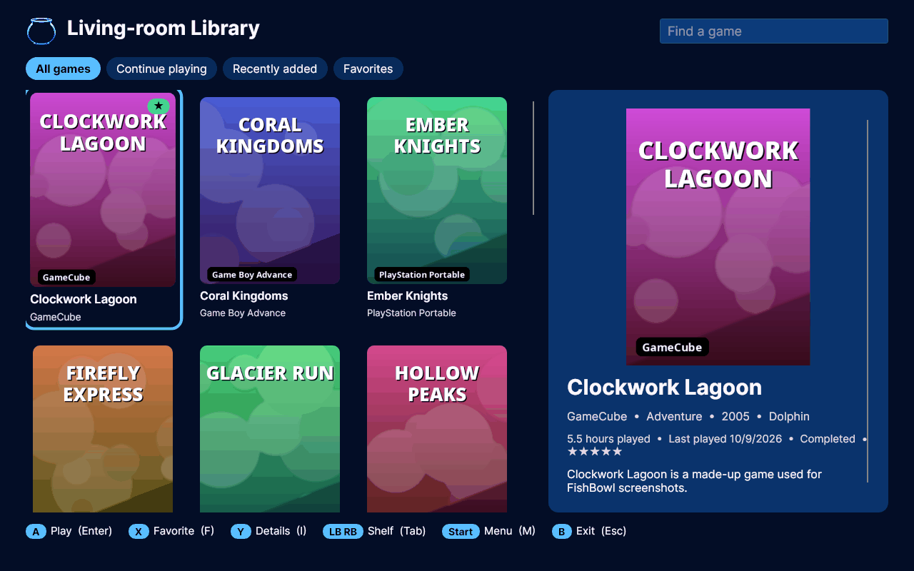

## Features

### Windows

- **Home, Emulators, Library, Play and Web** sections, with a continue-playing dashboard, pinned games and quick actions.
- **Play:** compatible Windows emulator windows appear inside FishBowl, using child hosting or a borderless window aligned to Play for per-monitor renderers. Sessions remain open when switching sections; Full screen expands the player, and Open in window restores the emulator’s own window. Closing FishBowl asks before requesting normal emulator shutdown; Cancel keeps the app open, and Keep games running restores external windows. Save and exit prompts are honored. Elevated, incompatible or renderer-managed windows may require Open in window. Remote hosting keeps the game in Play. Open in window changes to Return to Play for reattaching the same session.
- **Game library** with cover artwork, game identification, collections (including nested collections), smart lists, a play queue, favorites, ratings, progress and custom metadata. Already installed games can be launched directly.
- **Emulator management:**
  - presets for more than 40 emulators, plus custom emulators
  - setup checks and folder routing for saves, save states, configuration, screenshots and logs
  - registered builds with rollback, and release checks against official GitHub feeds
- **Saves and backups:** archive and restore emulator configuration, in-game saves and save states; snapshots of linked saves, with restore previews and optional scheduled captures.
- **Profiles:** separate favorites, progress, play time and appearance for each person, plus a temporary guest mode.
- **Living-room mode and controller navigation** for full-screen, couch-friendly browsing.
- **Appearance:**
  - 40 themes, 28 accents and custom palettes
  - compact controls with Standard/Roomy spacing options, harmonized theme colors and Original color blending
  - adjustable text size, corner rounding, icon styles and backgrounds
  - reduced-motion and accessibility presets, theme samples, restrained accents and cover proportions
  - Home card ordering and visibility with page scrolling
- **Tools:**
  - command search (Ctrl+K)
  - ROM verification against a local DAT file
  - CSV and HTML catalog export
  - transferring a profile between computers
  - game-specific setup and launch profiles, Steam discovery and explicit native executable/shortcut imports
  - reviewed mod overlays with verified backups, resumable rollback and IPS patch copies
  - manuals, trailer links, screenshot galleries, monthly play summaries and session notes
  - reviewed local/HTTPS metadata catalogs and declarative importer/emulator extensions
  - cached RetroAchievements completion progress (your API key is required)
  - a paired read-only browser companion for a phone on the same private network

### Linux

The Linux version shares the emulator presets, folder routing, backups and library format with Windows, and adds Linux integration:

- **Emulator types:** native programs, AppImages, Flatpaks, shell scripts and `.desktop` entries. Find installed detects Flatpaks, packages on the `PATH`, and AppImages in common folders.
- **Folder routing** follows each emulator's Linux layout: XDG folders such as `~/.config/PCSX2`, Flatpak sandboxes under `~/.var/app/<app ID>`, and portable markers.
- **Installed versions** come from Flatpak metadata, the distribution package (pacman, dpkg or rpm), or the AppImage file name.
- **Running emulators** are detected, including Flatpak and AppImage processes. Opening one that is already running brings its window forward on Hyprland, Sway and X11.
- **Importing:** AppImages and ZIP packages can be imported into a dedicated emulator folder.

The preview includes Home, Library, profiles, collections, keyboard/joystick living-room browsing, title/cover editing, removal with Undo, game setup, Steam import, integrations, mods, media, play history and verified file save recovery. Folder save archives use the emulator backup manager. Linux controller navigation reads controllers through evdev (`/dev/input/event*`), falling back to `/dev/input/js*`; mappings and device permissions depend on the system. The library file is shared; Linux preserves unfamiliar fields when it saves.

Session journals recover saved active time and resume verified running processes after restart. Time while FishBowl is closed is excluded; launchers without a verifiable process identity or ancestry remain uncertain. Linux leaves games running when FishBowl closes; Windows offers confirmed shutdown or explicit keep-running behavior. Windows includes browser window sharing and host-approved keyboard/gamepad-to-keyboard controls. Linux can join in the browser; native Linux hosting is not implemented. Remote play needs a configured LiveKit deployment and token service; see [setup and live-test checklist](remote-play/README.md).

## Installation

### Windows

Download the complete app ZIP or `FishBowl Setup.exe` from the [latest release](../../releases/latest) and run it, or download `FishBowl.exe` to run FishBowl without installing.

### Linux

Download `FishBowl-<version>-x86_64.AppImage` from the [latest release](../../releases/latest), make it executable (`chmod +x FishBowl-*.AppImage`, or your file manager's "Allow executing as program") and run it. It works on most x86_64 distributions without installing anything.

To build and install from source instead: building requires the [.NET 10 SDK](https://dotnet.microsoft.com/download). The installed program is self-contained and does not need .NET.

```sh
linux/install-linux.sh     # installs to ~/.local/lib/fishbowl and adds a menu entry and the fishbowl command
linux/uninstall-linux.sh   # removes the program; your library is kept
```

To run from source without installing: `dotnet run --project FishBowl.Avalonia`. To build an AppImage yourself: `linux/build-appimage.sh`.

## Tutorials

Short walkthroughs of common tasks. The steps and menu names follow the Linux version. Windows has the same features, though some menu names differ.

FishBowl doesn't include or download emulators, games, BIOS, firmware or keys. Install emulators from their official sites or your distribution, and use only games and firmware you are legally allowed to use.

### 1. Add your emulators

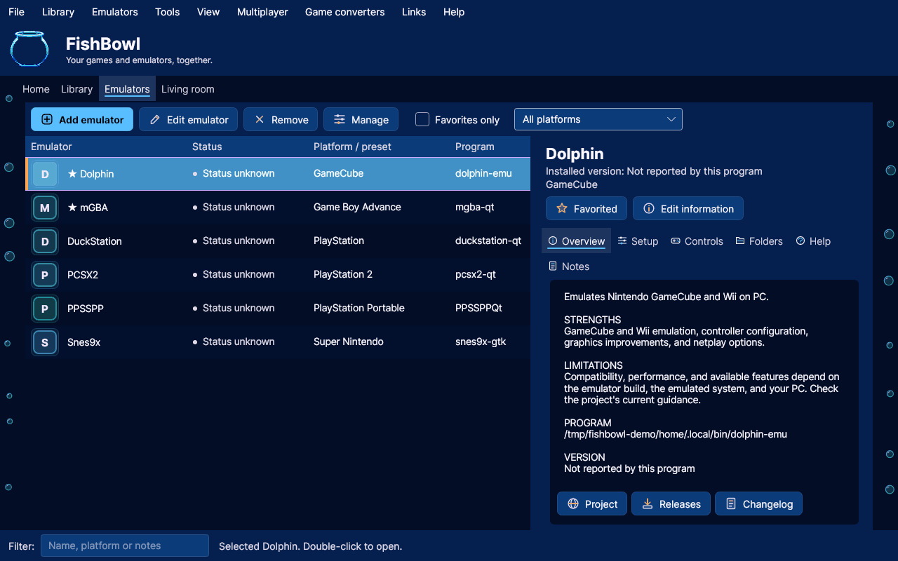

1. Install your emulators the usual way, for example as Flatpaks, distribution packages or AppImages.
2. In FishBowl, choose **Emulators > Find installed emulators...**, then **Find installed emulators**.
3. Check the programs you want and click **Add checked programs**. To add one by hand instead, click **Add emulator** on the Emulators page and pick its preset and program.
4. Select an emulator to see its overview, setup, controls and folders on the right.

### 2. Add your games

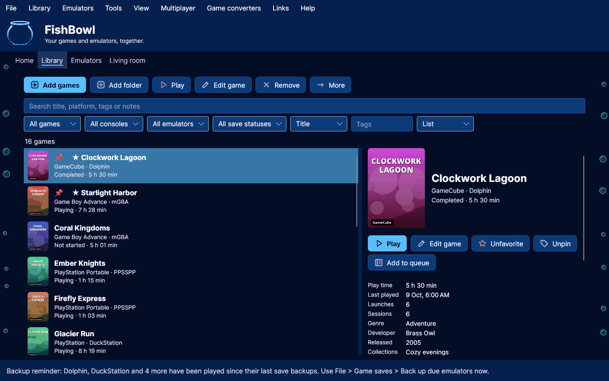

1. Open the **Library** tab.
2. Click **Add games** to choose files, or **Add folder** to add every file in a folder that your emulators can open. Your files stay where they are.
3. FishBowl names each game from the file and its built-in information, and picks the emulator by file type. If it can't tell which emulator to use, it asks when you first play the game.
4. To fix a title, cover, platform or rating, select the game and click **Edit game**.

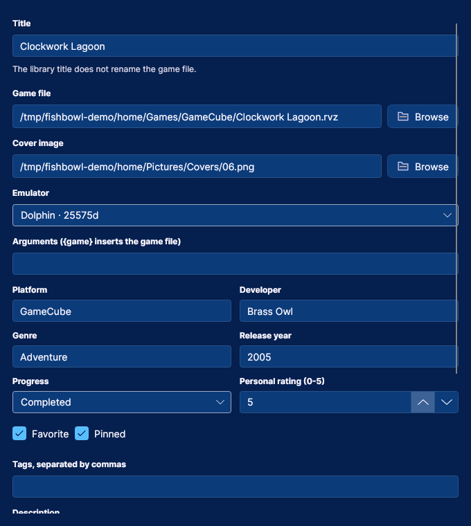

### 3. Play and track your time

1. Select a game and click **Play**, or press Enter. FishBowl opens it in its emulator.
2. FishBowl records how long the emulator runs. Play time, recent sessions and **Continue playing** on Home update when you close the emulator.
3. **Library > Session journal and charts...** shows every session. You can correct a session if the timing was off.
4. Mark games as **Favorite** or **Pin** them to keep them on Home, and use **Add to queue** for what you want to play next.

### 4. Check that an emulator is set up

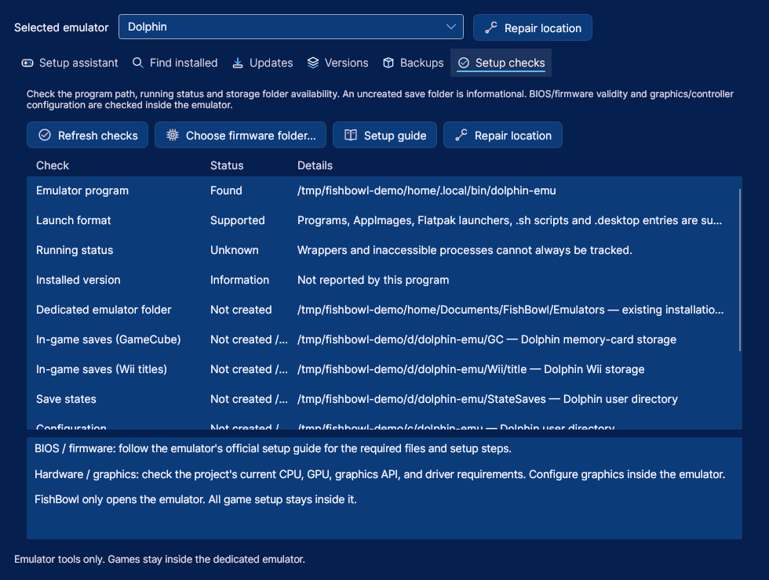

1. Select the emulator, then choose **Emulators > Setup checks...**.
2. FishBowl checks that the program exists and shows where the emulator keeps its saves, save states and settings.
3. BIOS and firmware setup happens inside the emulator. **Setup guide** opens the emulator's official instructions.

### 5. Keep your saves safe

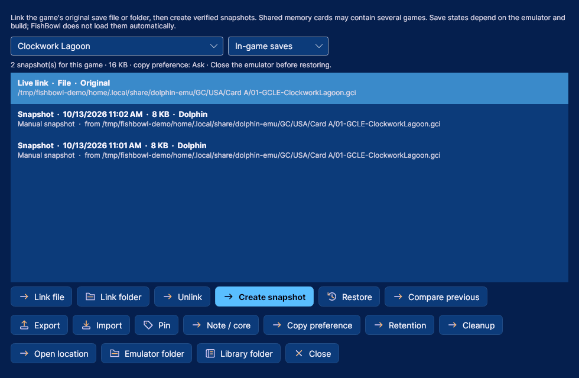

1. Select a game in the Library and click **Save history** in its details.
2. Click **Link file** or **Link folder**, and choose the emulator's save file for that game (the setup checks show where the emulator keeps them).
3. Click **Create snapshot** whenever you want a copy. FishBowl verifies each copy.
4. To go back, close the emulator, select a snapshot and click **Restore**. FishBowl shows what will change and keeps a copy of the current save first.

To back up a whole emulator (settings, in-game saves and save states), choose **File > Emulator backups / restore...**, then **Preview backup** and **Create backup**. Game files and emulator programs are never included.

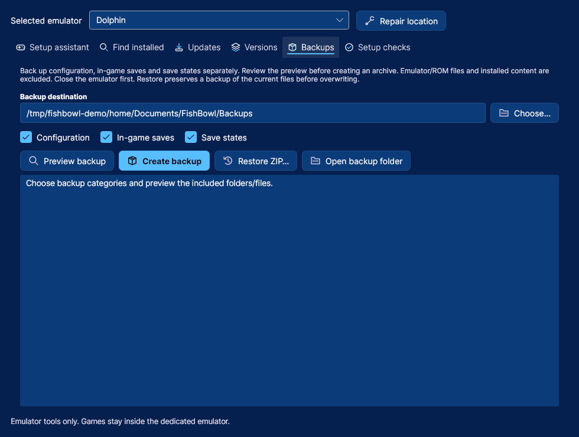

### 6. Play from the couch

1. Choose **View > Living-room Library**, or press Ctrl+B.
2. Use a controller or the keyboard: A (Enter) plays, X (F) favorites, Y (I) shows details, LB and RB (Tab) switch shelves, Start (M) opens the menu and B (Esc) exits.
3. **View > Immersion settings...** sets backgrounds, sounds, the theme bubbles, and an artwork slideshow after idle time.

On Linux, FishBowl reads controllers from `/dev/input`. Your user needs read access to the controller's device, which most desktop distributions give the signed-in user.

### 7. Set up a game

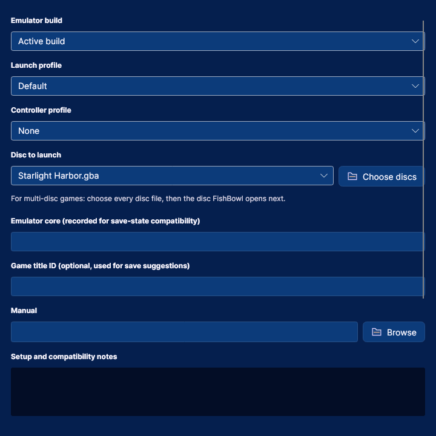

Select a game and click **Game setup** in its details to choose its emulator build, launch profile and controller profile. For multi-disc games, click **Choose discs**, select every disc file, then pick the disc FishBowl opens next. **Launch preview** in the game's details shows exactly what Play will run.

### 8. Linux: GameMode, MangoHud, Gamescope and Proton

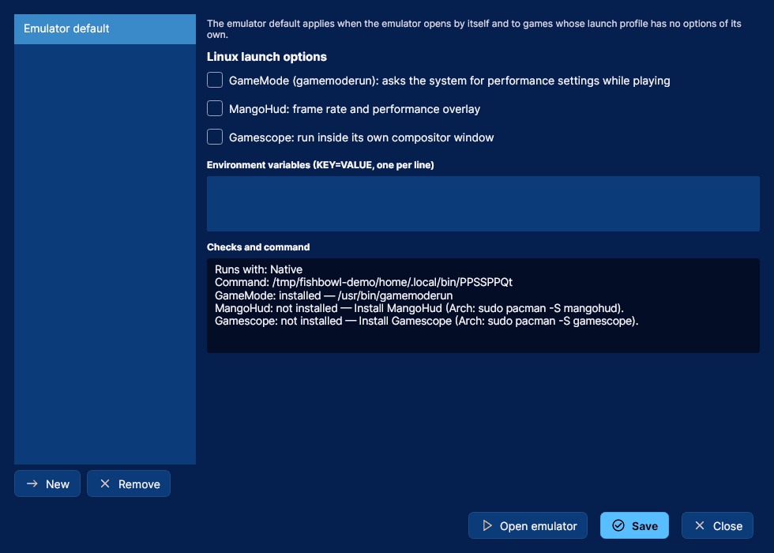

1. Select an emulator and choose **Emulators > Launch profiles...**.
2. Under **Emulator default**, check **GameMode**, **MangoHud** or **Gamescope**, or add environment variables. **Checks and command** shows whether each tool is installed and the exact command.
3. To use different options for some games only, click **New** to make a launch profile, then pick it in that game's **Game setup**.
4. If the emulator is a Windows program (`.exe`), FishBowl runs it through Proton (with umu-launcher) or Wine. Choose which, and the Proton build, in the same dialog.

## Where FishBowl keeps your data

| | Library and settings |
| --- | --- |
| Windows | `%LOCALAPPDATA%\FishBowl\library.json` |
| Linux | `~/.local/share/FishBowl/library.json` |
| Portable mode | A `FishBowlData` folder beside the program, used when an empty `portable.flag` file is present |

Saves are atomic, and the previous file is kept as `library.json.bak`. An unreadable library is preserved as a recovery copy instead of being overwritten.

What FishBowl never does on its own:
- **Emulators:** it opens your installed emulators and official project pages. It never downloads, installs or replaces emulator builds.
- **Firmware:** it never includes or downloads BIOS, firmware or keys.
- **Emulator files:** folder detection only reads emulator settings. Restoring a backup or changing a file happens only after you confirm it.

## Building from source

### Windows

The release source lives in [`windows/`](windows/) and builds with the .NET Framework C# compiler included in Windows:

```powershell
windows\Build.ps1          # builds FishBowl.exe and FishBowl Setup.exe
windows\Package.ps1        # complete six-file app bundle, source ZIP and SHA256SUMS
& "windows\Run Tests.ps1"  # runs the regression suite against a temporary portable library
```

### Linux

```sh
dotnet build FishBowl.Avalonia                        # the Linux app
dotnet run --project tests/FishBowl.Tests             # shared-logic tests
dotnet run --project tests/FishBowl.SchemaTests       # library format compatibility tests
```

### Continuous integration

Every push and pull request is checked by GitHub Actions:
- **Windows:** builds the app with `csc.exe`, runs the Windows regression suite, and checks that the shared files still compile as C# 5.
- **Linux:** builds and tests the Linux app, and publishes a Linux build.
- **Text overflow audit:** a separate workflow opens every Windows dialog at 100%, 150% and 200% text size and reports text that doesn't fit.

## Integrations and releases

RetroAchievements progress refreshes only on request and shows up to 500 account games. Achievement unlocking stays in the emulator. Windows can remember a Web API key encrypted for the current Windows account; Linux accepts `FISHBOWL_RA_API_KEY` or a key for the current request. Keys are not part of exported libraries.

Extensions are declarative JSON manifests of kind `Metadata`, `Importer` or `Emulator`. Catalog changes and import entries are reviewed before applying. Metadata matches require a unique normalized title and preserve custom titles. Extensions register data and adapters; they do not execute extension code. Use Create example in Extensions to generate a manifest and matching catalog.

The companion starts explicitly on localhost or a selected private network address. Its random pairing address grants read-only title and play-history access while it is running. Closing it stops the server. It does not serve game files, save contents, local paths or credentials.

Every passing Build provides a complete Windows app ZIP, a source ZIP, SHA256 checksums and a Linux executable artifact. After review, tag the matching source version (for example, `v1.29.4` for source version 1.29.4). Release packages verifies the installer/app versions and creates a draft release for the owner to review. Source ZIPs contain code; app ZIPs contain the executable and setup files.

## Repository layout

| Path | Contents |
| --- | --- |
| `windows/` | Windows release source, build and test scripts, and change notes |
| `FishBowl.Model.cs` | The library data model (`library.json`), shared by both versions |
| `FishBowl.Games.cs`, `FishBowl.Library.cs`, `FishBowl.LivingRoom.cs`, `FishBowl.SaveTools.cs`, `FishBowl.Sessions.cs` | Shared library, living-room, save and session helpers |
| `FishBowl.GameRecognition.cs` | Game identification from local metadata, shared by both versions |
| `FishBowl.Core.cs`, `FishBowl.Platform.cs` | Shared emulator logic, and the differences between Windows and Linux |
| `FishBowl.Avalonia/` | The Linux user interface |
| `linux/` | Linux install scripts and desktop entry |
| `tests/` | Linux and compatibility tests |
| `Folder Routing.md` | How FishBowl finds each emulator's save, state and configuration folders |
| `HANDOFF.md`, `AGENTS.md` | Current development status and instructions for contributors' coding agents |

Shared files must stay compatible with C# 5, because the Windows build uses the .NET Framework compiler. See [SOURCE-LAYOUT.md](SOURCE-LAYOUT.md) for how the two builds fit together.

## Contributing

- **Bugs:** report them with the [bug report form](../../issues/new/choose).
- **Changes:** make them on a branch and open a pull request into `main`. The checks must pass before merging.
- **Ground rules:** [DESIGN.md](DESIGN.md) covers how the Windows and Linux versions are developed together: shared files, the C# 5 requirement, library compatibility and the release process.
